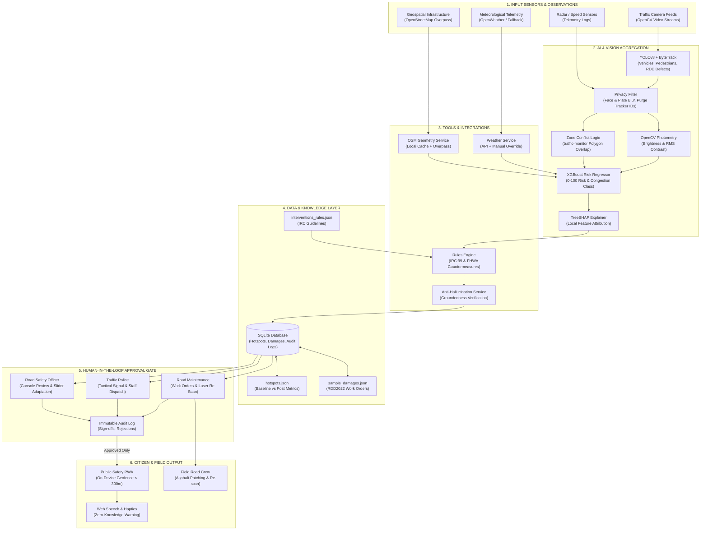

# RoadGuard AI - System Architecture

## Architectural Tenets
1. **Unidirectional Privacy Pipeline:** Sensor streams discard tracking IDs immediately after window aggregation. No facial images or license plates ever persist in the database.
2. **Grounded Explanations:** Every prediction is decomposed via TreeSHAP and verified against computed sensor evidence. Unsupported claims default to `"insufficient evidence"`.
3. **Strict Approval Gate:** Unapproved hotspots cannot be queried by the public client under any condition.
